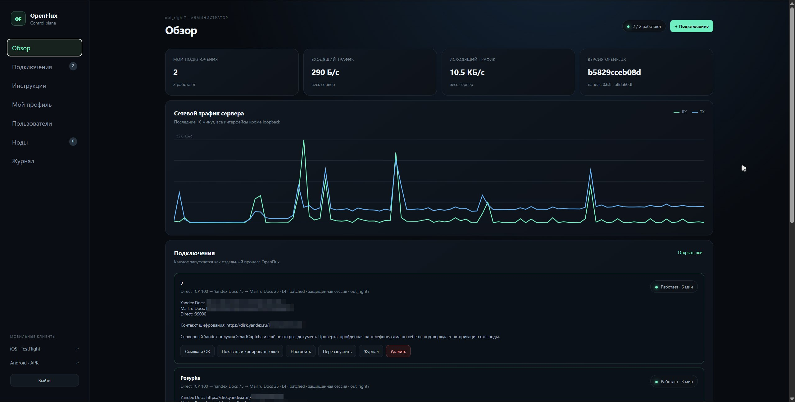
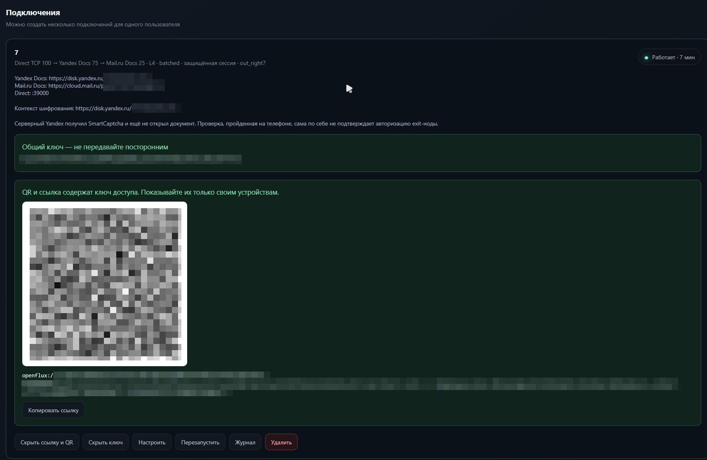
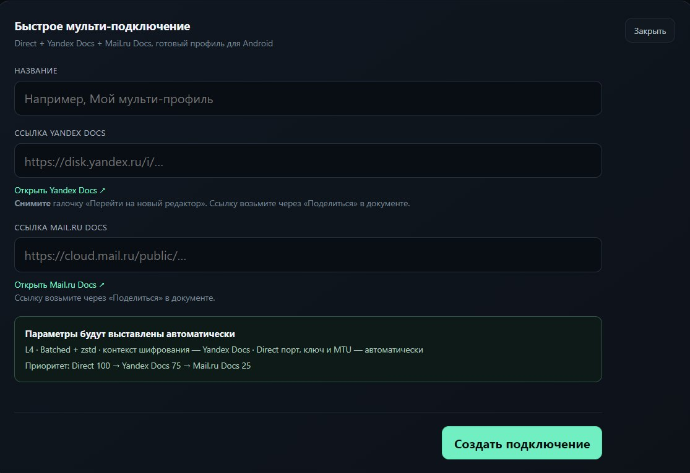
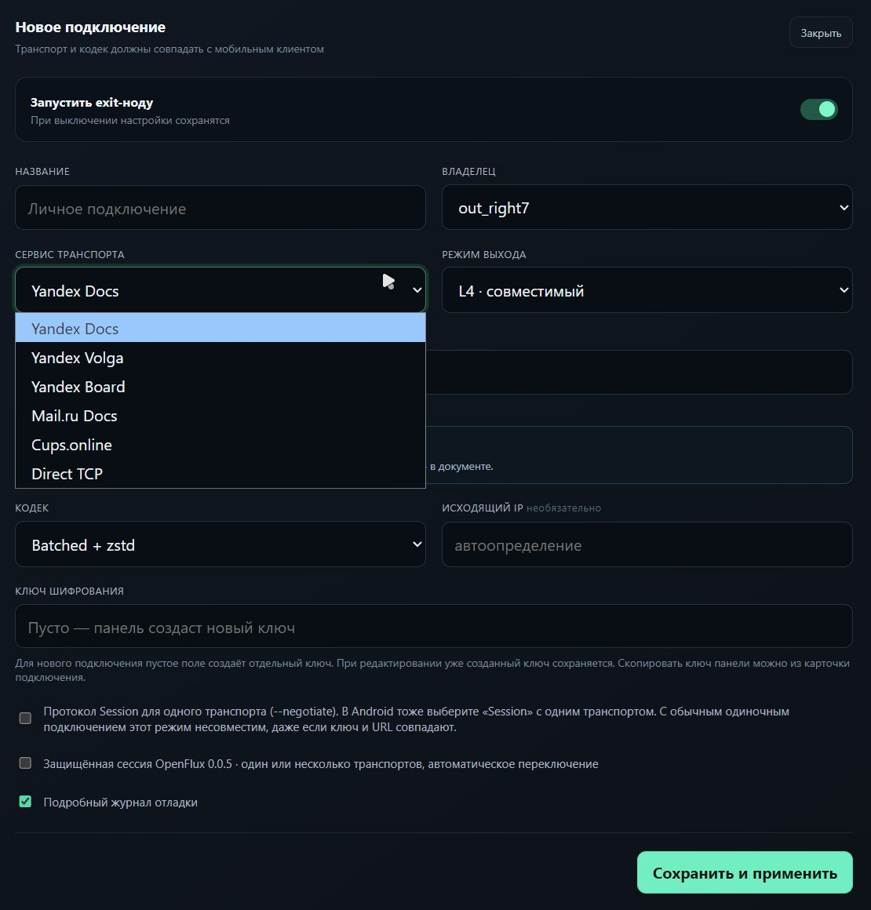
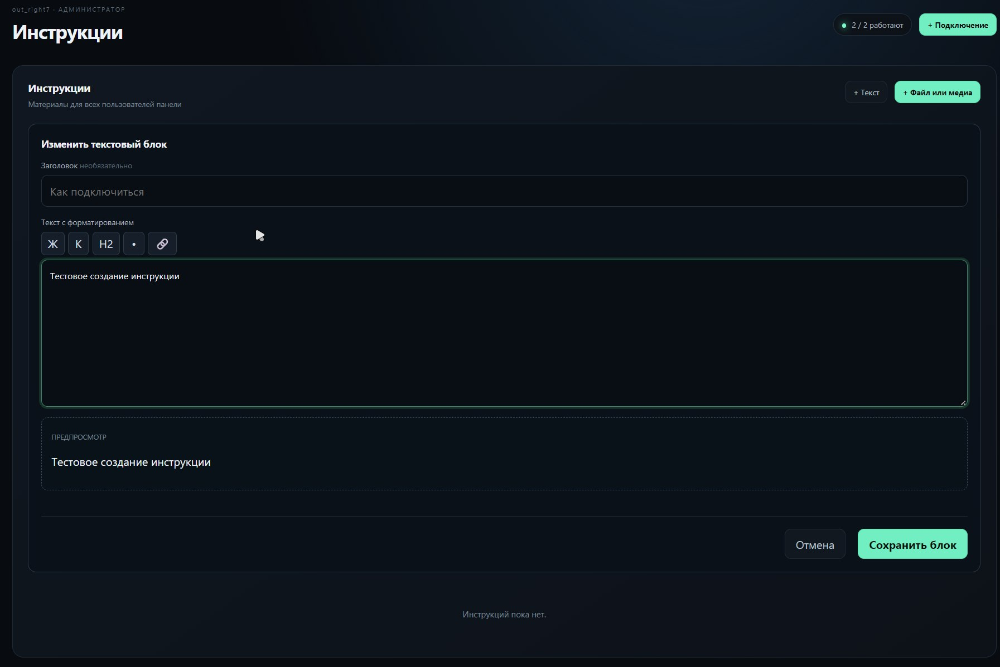
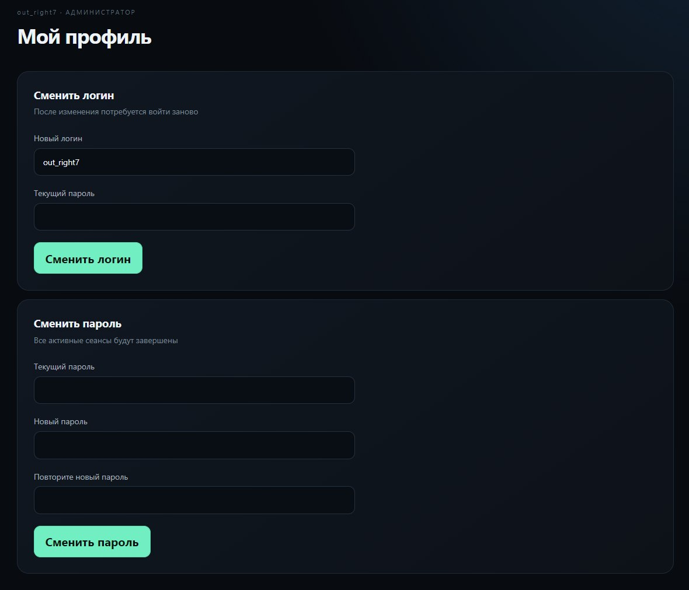
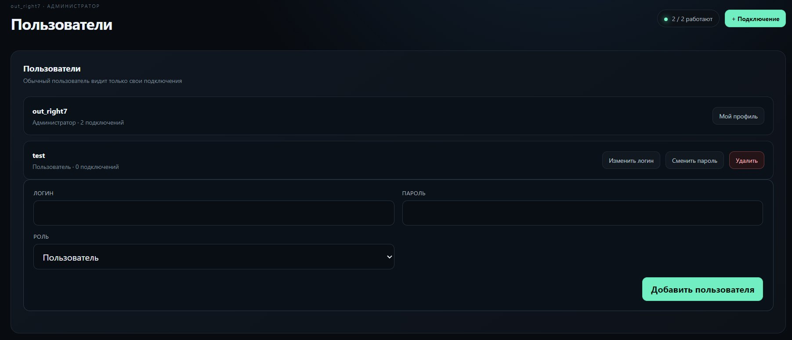
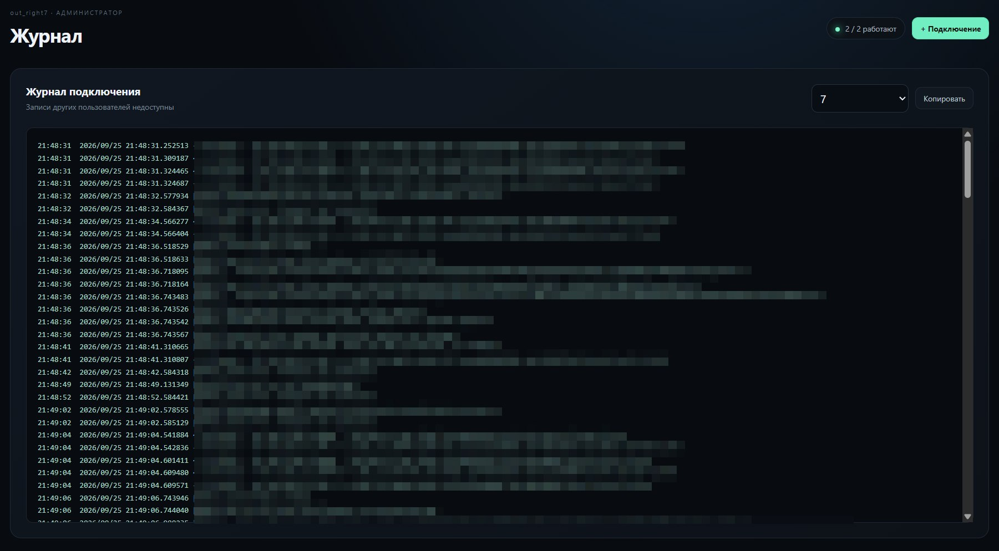

<div align="center">

# OpenFlux Deploy

### Сервер OpenFlux и панель управления — без ручной настройки

Установка на VPS одной командой · Docker или systemd · управление подключениями и пользователями

[**Установить**](#установка) · [Возможности](#возможности) · [Интерфейс](#интерфейс) · [Мобильные приложения](#мобильные-приложения)

[](LICENSE)
[](https://github.com/p1neappleXpress/OpenFluxAndroid/blob/main/LICENSE)
[](https://github.com/p1neappleXpress/OpenFlux/blob/main/LICENSE)

</div>

---

## Установка

Выполните на VPS от имени root:

```bash
bash -c "$(wget -qO- https://raw.githubusercontent.com/vnenapravo7-source/openflux-deploy/main/deploy.sh)"
```

Установщик предложит Docker или systemd. Режим можно указать сразу:

```bash
# systemd
bash -c "$(wget -qO- https://raw.githubusercontent.com/vnenapravo7-source/openflux-deploy/main/deploy.sh)" -- --mode systemd

# Docker
bash -c "$(wget -qO- https://raw.githubusercontent.com/vnenapravo7-source/openflux-deploy/main/deploy.sh)" -- --mode docker
```

После установки сохраните адрес панели и учётные данные из консоли.

### Выбор ядра

По умолчанию устанавливается совместимая линия `p1neappleXpress/OpenFlux`. Для нового VPS с ядром **OpenFluxTeam v0.16+** добавьте `--core team`:

```bash
bash -c "$(wget -qO- https://raw.githubusercontent.com/vnenapravo7-source/openflux-deploy/main/deploy.sh)" -- --core team
```

Ядра развиваются независимо. В уже установленной панели линия `p1` предлагает кнопку **«Перейти на Team 0.16»** в разделе «Обслуживание»: переход пересобирает ядро, перезапускает подключения, сохраняет предыдущий бинарник для отката и проверяет, что панель осталась работоспособной. После перехода проверка обновлений отслеживает стабильные теги OpenFluxTeam. Не прерывайте процесс и не перезагружайте VPS до результата проверки работоспособности.

## Удаление

Удалятор определит установку Docker/systemd и остановит панель вместе с запущенными через неё процессами OpenFlux. По умолчанию конфигурация и данные сохраняются.

```bash
wget -qO- https://raw.githubusercontent.com/vnenapravo7-source/openflux-deploy/main/uninstall.sh | sudo bash -s -- --yes
```

Чтобы удалить также пользователей, настройки, ключи, сертификаты, журналы и резервные копии:

```bash
wget -qO- https://raw.githubusercontent.com/vnenapravo7-source/openflux-deploy/main/uninstall.sh | sudo bash -s -- --purge-data --yes
```

Первая команда сразу удалит панель и управляемые процессы, сохранив конфигурацию и данные. Вторая команда с `--purge-data --yes` дополнительно удалит их. Обе команды запускаются без запроса подтверждения. Перед запуском убедитесь, что выбрали нужный VPS. Правила системного firewall и установленные Docker/Go пакеты удалятор не меняет. Если удаляете ноду, запускайте команду именно на VPS этой ноды.

## Возможности

<table>
<tr>
<td width="50%"><b>Подключения</b><br>Yandex Docs, Volga, Board, Telemost, Mail.ru Docs, Cups.online, Avito Code и Direct TCP; отдельные и мульти-профили, QR и ссылки <code>openflux://</code>.</td>
<td width="50%"><b>Панель</b><br>Пользователи и роли, журнал, статистика трафика, редактируемые инструкции с медиа.</td>
</tr>
<tr>
<td><b>Обслуживание</b><br>Проверка обновлений, автообновление и откат панели и серверной части.</td>
<td><b>Установка</b><br>Одна команда; Docker или systemd.</td>
</tr>
</table>

## Интерфейс

Нажмите на скриншот, чтобы открыть полноразмерное изображение.

<table>
<tr><td align="center" width="50%"><b>Обзор</b><br><a href="https://raw.githubusercontent.com/vnenapravo7-source/openflux-deploy/main/assets/screenshots/overview.jpg"></a><br><sub><a href="https://raw.githubusercontent.com/vnenapravo7-source/openflux-deploy/main/assets/screenshots/overview.jpg">Открыть полный размер ↗</a></sub></td><td align="center" width="50%"><b>Подключения</b><br><a href="https://raw.githubusercontent.com/vnenapravo7-source/openflux-deploy/main/assets/screenshots/connections.jpg"></a><br><sub><a href="https://raw.githubusercontent.com/vnenapravo7-source/openflux-deploy/main/assets/screenshots/connections.jpg">Открыть полный размер ↗</a></sub></td></tr>
<tr><td align="center" width="50%"><b>Мульти-профиль</b><br><a href="https://raw.githubusercontent.com/vnenapravo7-source/openflux-deploy/main/assets/screenshots/quick-multi.jpg"></a><br><sub><a href="https://raw.githubusercontent.com/vnenapravo7-source/openflux-deploy/main/assets/screenshots/quick-multi.jpg">Открыть полный размер ↗</a></sub></td><td align="center" width="50%"><b>Создание</b><br><a href="https://raw.githubusercontent.com/vnenapravo7-source/openflux-deploy/main/assets/screenshots/new-connection.jpg"></a><br><sub><a href="https://raw.githubusercontent.com/vnenapravo7-source/openflux-deploy/main/assets/screenshots/new-connection.jpg">Открыть полный размер ↗</a></sub></td></tr>
<tr><td align="center" width="50%"><b>Инструкции</b><br><a href="https://raw.githubusercontent.com/vnenapravo7-source/openflux-deploy/main/assets/screenshots/instructions.jpg"></a><br><sub><a href="https://raw.githubusercontent.com/vnenapravo7-source/openflux-deploy/main/assets/screenshots/instructions.jpg">Открыть полный размер ↗</a></sub></td><td align="center" width="50%"><b>Профиль</b><br><a href="https://raw.githubusercontent.com/vnenapravo7-source/openflux-deploy/main/assets/screenshots/profile.jpg"></a><br><sub><a href="https://raw.githubusercontent.com/vnenapravo7-source/openflux-deploy/main/assets/screenshots/profile.jpg">Открыть полный размер ↗</a></sub></td></tr>
<tr><td align="center" width="50%"><b>Пользователи</b><br><a href="https://raw.githubusercontent.com/vnenapravo7-source/openflux-deploy/main/assets/screenshots/users.jpg"></a><br><sub><a href="https://raw.githubusercontent.com/vnenapravo7-source/openflux-deploy/main/assets/screenshots/users.jpg">Открыть полный размер ↗</a></sub></td><td align="center" width="50%"><b>Журнал</b><br><a href="https://raw.githubusercontent.com/vnenapravo7-source/openflux-deploy/main/assets/screenshots/logs.jpg"></a><br><sub><a href="https://raw.githubusercontent.com/vnenapravo7-source/openflux-deploy/main/assets/screenshots/logs.jpg">Открыть полный размер ↗</a></sub></td></tr>
</table>


## Мобильные приложения

- [Android-приложение и релизы](https://github.com/p1neappleXpress/OpenFluxAndroid/releases/latest) · [репозиторий](https://github.com/p1neappleXpress/OpenFluxAndroid) · GPL-3.0
- [iOS · TestFlight](https://testflight.apple.com/join/BwnAcdus)

## Проекты и лицензии

| Проект | Назначение | Лицензия |
|---|---|---|
| [openflux-deploy](https://github.com/vnenapravo7-source/openflux-deploy) | Эта панель и установщик | [GPL-3.0](LICENSE) |
| [OpenFlux](https://github.com/p1neappleXpress/OpenFlux) | Серверное ядро | [GPL-3.0](https://github.com/p1neappleXpress/OpenFlux/blob/main/LICENSE) |
| [OpenFluxAndroid](https://github.com/p1neappleXpress/OpenFluxAndroid) | Android-клиент | [GPL-3.0](https://github.com/p1neappleXpress/OpenFluxAndroid/blob/main/LICENSE) |

<sub>Серверное ядро развивается авторами основного проекта. Здесь поддерживаются установщик и веб-панель.</sub>
